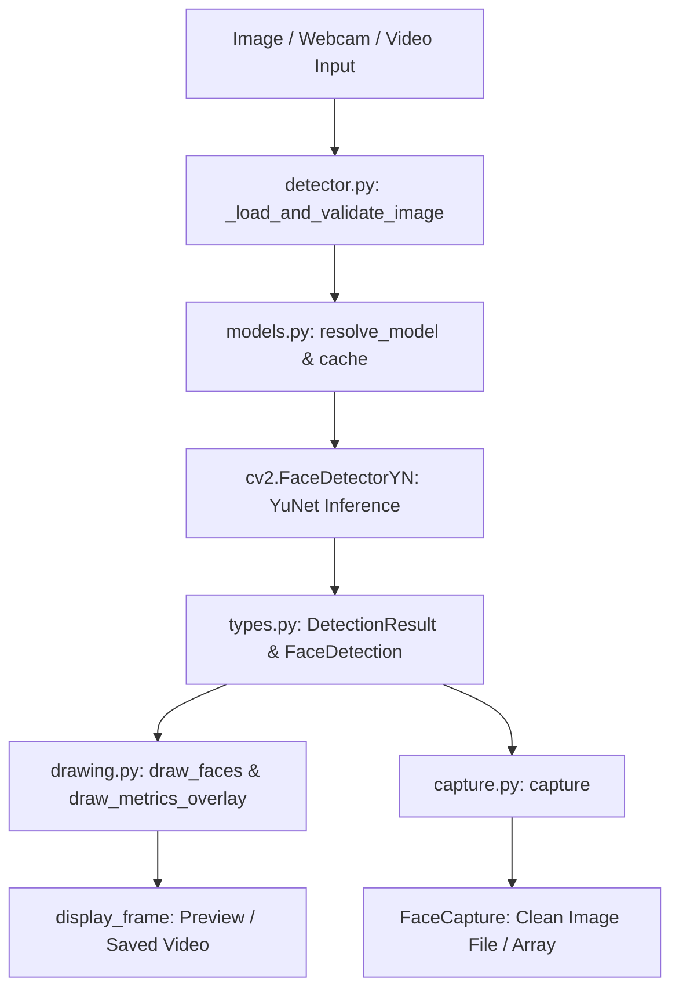

<p align="center">
  
</p>

# DetekFace

A clean, reliable, and beginner-friendly Python face detection package powered by **YuNet** and **OpenCV**.

---

## 1. Project Overview

**DetekFace** provides high-performance deep learning face detection in Python with zero complicated setup. Whether you need a 2-line live webcam feed with sci-fi overlays, face cropping for profile avatars, still-image batch processing, or offline video analysis, DetekFace provides a consistent, pythonic interface designed for humans.

---

## 2. Implemented Features

- **2-Line Live Webcam**: Start a real-time face detection camera stream with `detekface.camera()`.
- **Still-Image Face Detection**: Inspect faces, bounding boxes, confidence scores, and 5 facial landmarks using `detekface.detect()`.
- **Pure Face Cropping & Capture**: Extract clean, unpolluted face crops programmatically or interactively using the `c` key. Overlays and annotations never contaminate captured crops.
- **5 Distinct Visual Overlay Styles**: Render tactical corner brackets, modern rounded boxes, classic rectangles, geometric circles, or a full sci-fi HUD.
- **Live Throughput & Count Overlays**: Display smoothed processing FPS throughput, detected face counts, and confidence score badges.
- **Prerecorded Video Processing**: Process video files frame-by-frame with resolution and framerate preservation via `detekface.video()`.
- **Automatic Model Management**: Official YuNet ONNX models are automatically downloaded from trusted OpenCV Model Zoo mirrors, validated with SHA256 checksums, and cached locally.
- **Beginner-Friendly Error Handling**: Custom exception hierarchy with clear, actionable hints for camera disconnects, invalid files, or corrupt models.

---

## 3. How Face Detection Works: A Visual Overview

```
                      +-----------------------------+
                      |   Input Source              |
                      |   (Webcam / Image / Video)  |
                      +--------------+--------------+
                                     |
                                     v [BGR Image Frame]
                      +-----------------------------+
                      |   YuNet Deep Learning Model |
                      |   (via OpenCV Graph Engine) |
                      +--------------+--------------+
                                     |
                                     v [Coordinates & Confidences]
                      +-----------------------------+
                      |   Detection Engine Parser   |
                      |   (Bounding Box + Landmarks)|
                      +--------------+--------------+
                                     |
            +------------------------+------------------------+
            |                                                 |
            v                                                 v
  +--------------------+                           +--------------------+
  |  Overlay Renderer  |                           |  Face Capture Crop |
  |  (Draws Overlays   |                           |  (Extracts from    |
  |   on Display Copy) |                           |   Original Frame)  |
  +---------+----------+                           +---------+----------+
            |                                                 |
            v                                                 v
[Annotated Preview / Video]                         [Clean Unpolluted Crop]
```

1. **Frame Ingestion**: An image, video frame, or webcam feed is converted into a standard 3-channel BGR uint8 NumPy array.
2. **Inference**: The frame is forwarded through the YuNet convolutional neural network via OpenCV's `FaceDetectorYN`.
3. **Parsing**: The raw network predictions are decoded into high-level dataclasses containing bounding box coordinates `(x, y, width, height)`, detection confidence `(0.0 to 1.0)`, and 5 facial keypoints (eyes, nose tip, mouth corners).
4. **Overlay Rendering**: Visual indicators are drawn onto a *copy* of the frame for display or video export.
5. **Crop Purity**: When cropping faces, DetekFace slices directly from the *pristine original frame*, ensuring saved face images remain 100% clean and free of drawn graphics.

---

## 4. Architecture Overview

DetekFace is designed around separation of concerns:



- **`models.py`**: Resolves model version compatibility (dynamic-shape `yunet_2026may` for OpenCV 5.x, fixed-shape `yunet_2023mar` for OpenCV 4.x), verifies SHA256 hashes, and manages atomic user caching.
- **`detector.py`**: Validates dimensions, handles color-space conversions (Grayscale, BGRA, float to uint8), and executes inference.
- **`drawing.py`**: Pure rendering module supporting 5 overlay shapes, RGB/hex-to-BGR color mapping, and rolling-window FPS calculation.
- **`capture.py`**: Handles boundary clamping, largest-face selection, and unpolluted disk/memory image cropping.
- **`camera.py` & `video.py`**: Interactive streaming loops with keyboard polling and guaranteed resource cleanup.

---

## 5. Installation Requirements

- **Python**: `>= 3.9` through `3.15+` (tested on 3.15.1 64-bit).
- **Core Dependencies**:
  - `numpy>=1.20`
  - `opencv-python>=4.8` *(standard GUI-capable wheel; do not use `opencv-python-headless` if preview windows are required)*.

---

## 6. Windows 11 Installation Instructions

1. **Open PowerShell or Windows Terminal**:
   Verify Python is installed:
   ```powershell
   python --version
   pip --version
   ```

2. **Create and Activate a Virtual Environment** (Recommended):
   ```powershell
   python -m venv .venv
   .\.venv\Scripts\Activate.ps1
   ```
   *(If script execution is disabled on PowerShell, run: `Set-ExecutionPolicy -Scope Process -ExecutionPolicy Bypass`)*

3. **Install DetekFace**:
   Install from local wheel or editable checkout:
   ```powershell
   pip install .
   ```
   Or install in editable mode for development:
   ```powershell
   pip install -e ".[dev]"
   ```

---

## 7. Minimal Quick-Start

The simplest working example requires only 2 lines of Python:

```python
import detekface

detekface.camera()
```

This immediately opens your default camera, runs real-time face detection, and displays a green bounding box around detected faces.

---

## 8. Webcam Usage & Keyboard Controls

Launch the camera with custom options:

```python
import detekface

detekface.camera(
    camera_index=0,        # 0 for default webcam, 1 for external USB camera
    mirror=True,           # Horizontally flip for natural mirror view
    confidence_threshold=0.7,
    shape="hud",           # 'rectangle', 'corners', 'circle', 'rounded', 'hud'
    color="#00FF88",       # Hex code or name ('cyan', 'neon_green', 'red', etc.)
    thickness=3,           # Stroke width in pixels
    show_confidence=True,  # Show confidence score near face
    show_fps=True,         # Show smoothed real-time FPS
    show_count=True,       # Show current face count
)
```

### Interactive Keyboard Controls

During webcam or video playback:

| Key | Action | Description |
| :---: | :--- | :--- |
| **`c`** / **`C`** | **Capture Face** | Crops the largest visible face from the clean original frame and saves it to disk. |
| **`q`** / **`Q`** | **Quit** | Cleanly exits the preview window and releases the camera device. |
| **`Esc`** | **Exit** | Immediately closes all OpenCV windows and terminates the loop. |
| **`X`** | **Close Button** | Clicking the operating system window close button terminates safely without hanging. |

---

## 9. Visual Overlay Styles & Configuration Options

DetekFace provides 5 built-in face overlay shapes:

| Style | Argument | Visual Appearance |
| :--- | :--- | :--- |
| **Rectangle** | `shape="rectangle"` | Classic rectangular bounding box framing the face (default). |
| **Corners** | `shape="corners"` | Tactical corner brackets at the four corners of the face box. |
| **Circle** | `shape="circle"` | Geometric circle indicator enclosing the face *(geometric overlay, not a facial contour)*. |
| **Rounded** | `shape="rounded"` | Modern rounded rectangle with smooth circular corners. |
| **HUD** | `shape="hud"` | Sci-fi HUD overlay with corner brackets, reticle crosshair ticks, and target badge. |

### Color Formats

Colors accept any of the following:
- **RGB Hex Strings**: `"#00FF88"`, `"#00FFFF"`, `"#FF3366"`, `"#0F8"`
- **Documented Color Names**: `"green"`, `"neon_green"`, `"cyan"`, `"red"`, `"blue"`, `"yellow"`, `"magenta"`, `"orange"`, `"white"`, `"lime"`, `"teal"`, `"purple"`
- **RGB Tuples**: `(0, 255, 136)`, `(255, 0, 0)`

---

## 10. Face Capture, Cropping, & Callbacks

### Programmatic Capture

Crop the largest face or a specific face index from any `DetectionResult`:

```python
import detekface

result = detekface.detect("group_photo.jpg")

# 1. Capture and save the largest face to disk
face = result.capture(save_dir="captures", filename="avatar.jpg")
print(f"Saved {face.width}x{face.height}px crop to: {face.path}")

# 2. Capture in-memory without saving to disk
memory_face = result.capture(face_index=0, save=False)
bgr_array = memory_face.image   # NumPy array in BGR format
rgb_array = memory_face.rgb_image # NumPy array converted to RGB for PIL / Matplotlib
```

### Webcam Capture Callback

Receive captured faces programmatically whenever the user presses `C`:

```python
import detekface

def handle_capture(face: detekface.FaceCapture) -> None:
    print(f"Captured face: {face.width}x{face.height}px, score={face.confidence:.2f}")
    print(f"Saved file: {face.path}")

detekface.camera(on_capture=handle_capture)
```

---

## 11. Still-Image Detection & Result Objects

Detect faces in image files or NumPy arrays:

```python
import detekface

# Run detection
result = detekface.detect("photo.jpg", confidence_threshold=0.6)

# Inspect detection results
print(f"Faces found: {result.count}")
print(f"Has faces  : {result.has_faces}")

for face in result.faces:
    print(f"Confidence : {face.confidence * 100:.1f}%")
    print(f"Bounding Box: x={face.bbox.x}, y={face.bbox.y}, w={face.bbox.width}, h={face.bbox.height}")
    if face.landmarks:
        print(f"  Right Eye: {face.landmarks.right_eye.as_tuple()}")
        print(f"  Left Eye : {face.landmarks.left_eye.as_tuple()}")
        print(f"  Nose Tip : {face.landmarks.nose_tip.as_tuple()}")

# Preview annotated image in a window
result.show(shape="hud", color="cyan", show_confidence=True)

# Save annotated image with custom styling
result.save("output_annotated.jpg", shape="hud", color="#00FF88", show_confidence=True)
```

---

## 12. Prerecorded Video Support

Process video files frame-by-frame and export annotated video with preserved resolution and framerate:

```python
import detekface

saved_path = detekface.video(
    path="input_clip.mp4",
    output_path="annotated_clip.mp4",
    show=True,             # Set show=False for headless server processing
    shape="hud",
    color="#00FF88",
    show_confidence=True,
    show_fps=True,
    show_count=True,
)
print(f"Exported annotated video to: {saved_path}")
```

*(Note: Audio tracks are not re-encoded; only visual video frames are processed and exported).*

---

## 13. Configuration & Error Handling

DetekFace provides structured, actionable exceptions:

```python
import detekface
from detekface.exceptions import (
    CameraNotFoundError,
    ImageNotFoundError,
    InvalidImageError,
    NoFaceDetectedError,
)

try:
    result = detekface.detect("missing_file.jpg")
except ImageNotFoundError as e:
    print(f"Error: {e.message}")
    print(f"Hint : {e.hint}")
```

### Exception Hierarchy

```text
DetekFaceError
 ├── ModelError
 │    ├── ModelNotFoundError
 │    ├── ModelDownloadError
 │    ├── ModelCorruptionError
 │    └── ModelCompatibilityError
 ├── ImageError
 │    ├── ImageNotFoundError
 │    ├── InvalidImageError
 │    └── ImageSaveError
 ├── ConfigurationError
 ├── CameraError
 │    ├── CameraNotFoundError
 │    └── CameraReadError
 ├── CaptureError
 │    ├── NoFaceDetectedError
 │    ├── InvalidCropError
 │    └── CaptureSaveError
 └── VideoError
      ├── VideoNotFoundError
      ├── InvalidVideoError
      └── VideoWriteError
```

---

## 14. Supported Python & Dependency Versions

| Component | Supported Versions | Tested Environment |
| :--- | :--- | :--- |
| **Python** | `>= 3.9`, `3.10`, `3.11`, `3.12`, `3.13`, `3.14`, `3.15` | `3.15.1 64-bit` |
| **NumPy** | `>= 1.20` | `2.5.4` |
| **OpenCV** | `>= 4.8` (`opencv-python` or `opencv-contrib-python`) | `5.0.0.93` |
| **OS** | Windows 11, Windows 10, Linux, macOS | Windows 11 (AMD64) |

---

## 15. Model Acquisition, Caching, & Licensing

- **Automatic Download**: On first use, the model file is automatically downloaded from the official OpenCV Model Zoo.
- **Model Files**:
  - `face_detection_yunet_2026may.onnx` (dynamic shape for OpenCV 5.x graph engine)
  - `face_detection_yunet_2023mar.onnx` (for OpenCV 4.x)
- **Local Cache Directory**:
  - Windows: `%LOCALAPPDATA%\detekface` (e.g. `C:\Users\<User>\AppData\Local\detekface`)
  - Linux/macOS: `~/.cache/detekface`
- **Integrity Verification**: Downloads are validated against official SHA256 checksums before caching.
- **Custom Local Model**: Pass an explicit model path to bypass remote downloads:
  ```python
  import detekface

  detector = detekface.FaceDetector(model="C:/models/my_yunet.onnx")
  ```

---

## 16. Troubleshooting Common Issues

### Camera Not Opening (`CameraNotFoundError`)
- **Fix**: Check Windows Privacy Settings (**Settings -> Privacy & Security -> Camera**) and ensure camera access is allowed. Close other apps (Zoom, Teams) using the webcam. Try `camera_index=1` if multiple devices are attached.

### Display Errors in Headless / Server Environments
- **Fix**: If running on a headless server or Docker container without a graphical display, set `show=False` in `detekface.video()` or avoid calling `result.show()`.

### Corporate Proxy Blocking Model Downloads
- **Fix**: Download `face_detection_yunet_2026may.onnx` manually from the [OpenCV Zoo](https://github.com/opencv/opencv_zoo/tree/main/models/face_detection_yunet), place it in `%LOCALAPPDATA%\detekface`, or pass the local path via `model="path/to/model.onnx"`.

---

## 17. Testing Instructions

Run the complete automated test suite using `pytest`:

```powershell
pytest -v
```

Execute repeatable performance benchmarks:

```powershell
python examples/benchmark.py
```

---

## 18. Development Setup & Contributing

1. Clone the repository:
   ```powershell
   git clone https://github.com/Abishek-C0DE5/DetekFace.git
   cd DetekFace
   ```
2. Create and activate a virtual environment:
   ```powershell
   python -m venv .venv
   .\.venv\Scripts\Activate.ps1
   ```
3. Install editable dependencies:
   ```powershell
   pip install -e ".[dev]"
   ```
4. Run tests before submitting changes:
   ```powershell
   pytest
   ```

---

## 19. License Information

### Software License
DetekFace is released under the **MIT License**. See [LICENSE](LICENSE) for details.

### YuNet Model License & Credits
The YuNet face detection model was created by Shiqi Yu and is distributed under the **MIT License**:
- **Author**: Shiqi Yu (`libfacedetection`) & Shenzhen Institute of Artificial Intelligence and Robotics for Society
- **Model License**: MIT License (Copyright (c) 2020 Shiqi Yu)
- **Source**: [OpenCV Model Zoo](https://github.com/opencv/opencv_zoo/tree/main/models/face_detection_yunet)

---

## 20. Current Limitations & Future Improvements

### Current Limitations
1. **No Identity Tracking**: DetekFace detects face locations on each frame independently. It does not track individuals across frames or assign persistent IDs.
2. **Tiny Faces**: Faces smaller than ~20x20 pixels in high-resolution frames may require lowering `confidence_threshold` (e.g. `0.35`–`0.45`).
3. **Extreme Profiles**: Optimized for frontal and semi-profile views (up to ~60° yaw). Perpendicular side profiles (>60°) may have lower detection confidence.
4. **Video Audio**: Prerecorded video export processes visual frames only; audio streams are not re-encoded.

### Planned Improvements
- Optional face alignment normalization prior to saving crops.
- Batch image inference optimization for multi-core processing.
- Direct integration with camera resolution negotiation controls.
