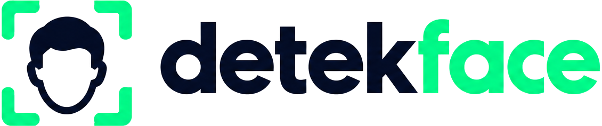

# DetekFace Documentation Index

  

Welcome to the official documentation for **DetekFace**, a high-performance, beginner-friendly Python face detection package powered by YuNet, OpenCV, and Google MediaPipe.

---

## Documentation Navigation

| Document | Topic & Focus | Best For |
| :--- | :--- | :--- |
| **[Installation](installation.md)** | System requirements, virtual environment setup on Windows 11, Linux, macOS, and OpenCV variants. | Setting up the package, environment configuration |
| **[Quick Start](quickstart.md)** | Core concepts (bounding boxes, confidence scores, landmarks, FPS) and minimal runnable examples. | Beginners learning computer vision |
| **[Webcam Streaming](webcam.md)** | Live camera feed (`camera()`), keyboard controls (`Q`, `Esc`, `C`), overlays, and advanced session lifecycle (`open_camera`). | Interactive apps, kiosks, webcam tools |
| **[Image Detection](image-detection.md)** | Detecting faces in still photos, inspecting coordinates, and integrating with PIL, Matplotlib, and OpenCV. | Single photo analysis, image scripts |
| **[Batch Processing](batch.md)** | Processing folders or image lists with `detect_many()`, progress callbacks, and memory management. | Large datasets, bulk photography pipelines |
| **[Video Processing](video.md)** | Frame-by-frame video detection, frame skipping, headless video export, and codec selection. | Video analysis, surveillance recordings |
| **[Face Capture & Cropping](face-capture.md)** | Extracting pristine, unpolluted face crops from images, webcams, or video feeds with smart boundary clamping. | Avatar generators, biometric datasets, profiling |
| **[Backend Selection](backends.md)** | Selecting between default YuNet and optional Google MediaPipe (`detekface[mediapipe]`) and landmark contracts. | Backend comparison, landmark requirements |
| **[Configuration & Styling](configuration.md)** | 5 overlay shapes (`rectangle`, `corners`, `circle`, `rounded`, `hud`), color parsing, status banners, and thresholds. | Visual customization, aesthetic tailoring |
| **[Facial Mesh & Live FX](facial-mesh.md)** | 478 dense landmark wireframes, 5 mesh styles (`wireframe`, `neon`, etc.), and animated Live FX scanner. | Face topology, AR wireframes, futuristic HUD |
| **[Face Shape Analysis](face-shape.md)** | Geometric proportion analysis, 6 canonical face shapes, and temporal smoothing. | Biometric classification, beauty tech |
| **[Multi-Face Tracking](tracking.md)** | Multi-face tracking engine, persistent ID assignment, and occlusion continuity. | Video tracking, multi-person surveillance |
| **[3D Head-Pose](pose.md)** | Euler angle estimation (Yaw, Pitch, Roll in degrees) and 3D orientation axis projection. | Driver attentiveness, user interface controls |
| **[Gesture Detection](gestures.md)** | Real-time blink, mouth, and head gesture detection with asynchronous callbacks. | Accessibility, touchless kiosk interactions |
| **[AR Accessories](accessories.md)** | Virtual sunglasses, crown, visor, face mask, and halo with alpha blending. | Augmented reality, social avatar filters |
| **[Face Alignment](alignment.md)** | Eye-level straightening and aspect-preserving standardized crops (112x112, 224x224). | Biometric normalization, training pipelines |
| **[Quality Assessment](quality.md)** | Objective capture quality assessment: sharpness, lighting, framing, and pose warnings. | Quality gates, capture compliance |
| **[Privacy Anonymization](privacy.md)** | Local privacy filters (blur, pixelate, solid mask) with fail-closed protection. | GDPR/HIPAA compliance, media privacy |
| **[Performance & 60 FPS](performance.md)** | Decoupled 4-stage async camera engine, capture/render/inference FPS, and benchmarks. | High-performance tuning, low-latency apps |
| **[API Reference](api-reference.md)** | Exhaustive reference of every public function, class, dataclass, method, property, and exception. | Complete API lookups, typing specifications |
| **[Troubleshooting & FAQ](troubleshooting.md)** | Solutions for camera permissions, missing GUI in headless environments, proxy/model download fixes. | Debugging errors, production deployment |
| **[Validation Methodology](validation.md)** | Legally compliant validation dataset, precision/recall/F1 metrics, IoU matching, and scenario challenges. | Model evaluation, reproducible benchmarks |
| **[Development & Contributing](development.md)** | Setup, test suites (`pytest`), linting (`ruff`), type checking (`mypy`), and distribution building. | Open-source contributors, maintainers |
| **[Licensing & Credits](licensing.md)** | DetekFace MIT license, YuNet model copyright (Shiqi Yu), MediaPipe Apache-2.0 license, and dataset terms. | Legal compliance, corporate deployment |

---

## Recommended Learning Paths

### Path A: Beginners & Quick Experimentation
1. Read **[Installation](installation.md)** to configure your Python environment.
2. Follow **[Quick Start](quickstart.md)** to understand basic computer vision concepts.
3. Launch **[Webcam Streaming](webcam.md)** with a single line of code (`detekface.camera()`).

### Path B: Production Pipelines & Datasets
1. Review **[Image Detection](image-detection.md)** and **[Batch Processing](batch.md)** for folder ingestion.
2. Read **[Face Capture](face-capture.md)** for unpolluted face crops and avatars.
3. Review **[Video Processing](video.md)** for video recordings with frame skipping.
4. Check **[Backend Selection](backends.md)** if comparing YuNet with Google MediaPipe.

### Path C: Contributors & Maintainers
1. Follow **[Development](development.md)** to clone and install in editable mode (`pip install -e .[dev,mediapipe]`).
2. Run test suites (`pytest -v`), linting (`ruff check .`), and type checking (`mypy`).
3. Consult the **[API Reference](api-reference.md)** and **[Validation Methodology](validation.md)**.
